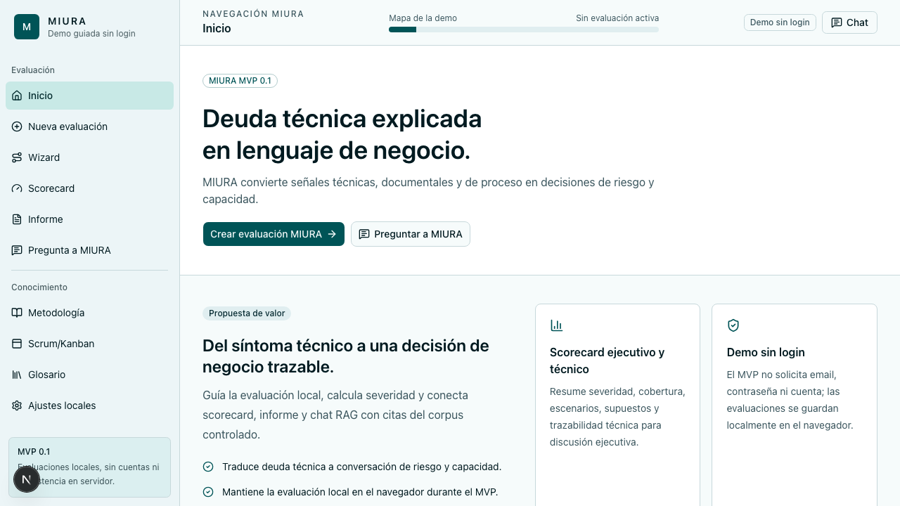
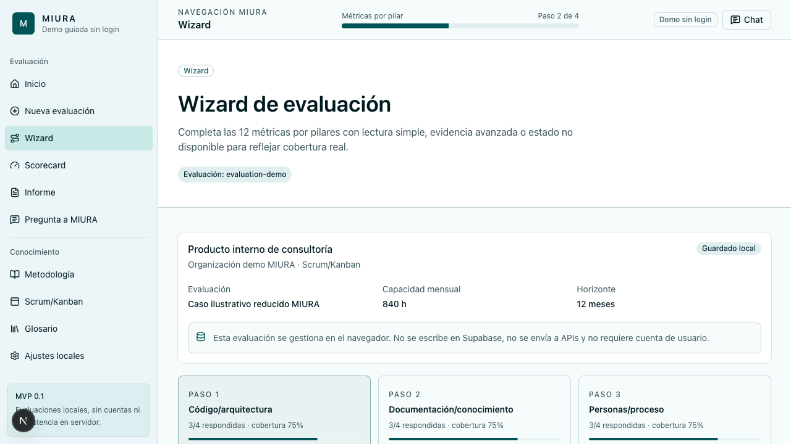
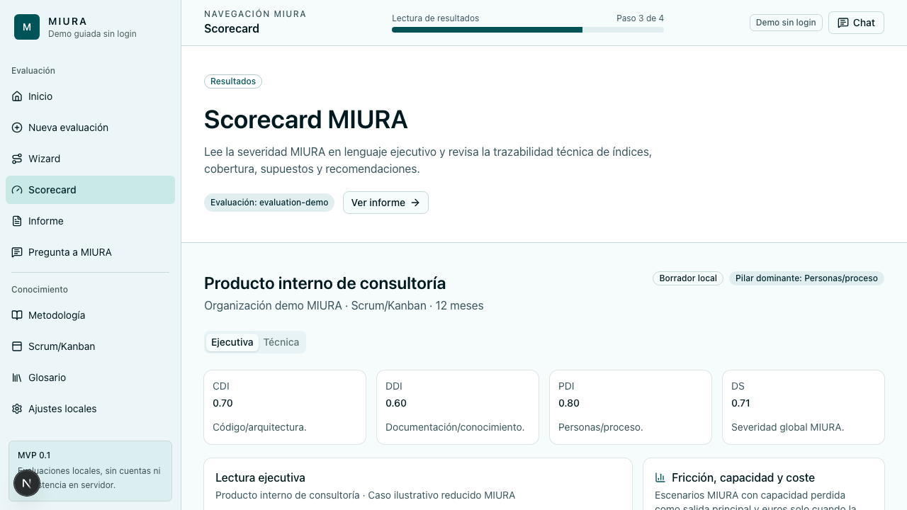
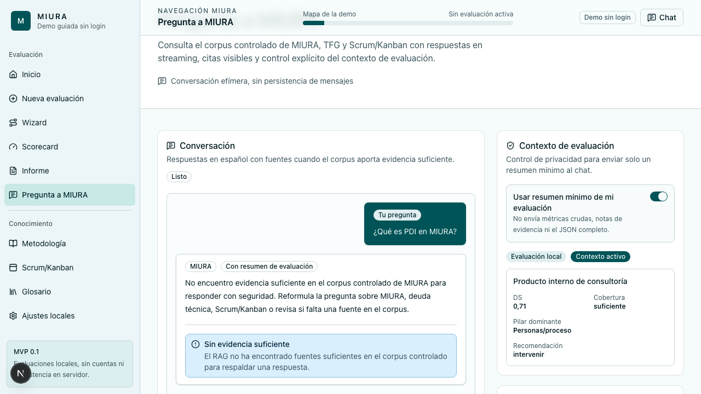

# MIURA Web App 🐂💻

MIURA Web App MVP 0.1 es una demo guiada sin login para explicar y evaluar
deuda tecnica con el framework MIURA. La app usa Next.js App Router, React,
TypeScript strict, Tailwind CSS v4, shadcn/ui, Zod, Supabase pgvector para el
corpus RAG, LangChain.js para retrieval y Vercel AI SDK para chat streaming.

Las evaluaciones de usuario viven en el navegador. Supabase se usa solo para
documentos, chunks, embeddings y citas del corpus RAG.

## Unidades del curso aplicadas

El proyecto cubre de forma directa cuatro unidades del enunciado de la practica:

- **Unidad 1 - IA Generativa y LLMs:** MIURA incorpora un asistente RAG que usa
  un LLM de OpenAI para responder en espanol sobre el corpus controlado del
  proyecto. El modelo se limita con contexto recuperado y avisos metodologicos
  para evitar presentar la deuda tecnica como una verdad contable exacta.
- **Unidad 2 - Prompt Engineering:** el chat usa un system prompt estructurado
  con rol, tono, restricciones de fuentes, politica anti-alucinacion,
  instrucciones contra prompt injection, contexto recuperado y contexto minimo
  opcional de evaluacion. No se usa chain-of-thought explicito porque la demo
  prioriza respuestas auditables con citas, no razonamiento oculto expuesto.
- **Unidad 3 - Transformers y APIs:** la aplicacion accede programaticamente
  a OpenAI mediante SDKs desde rutas y scripts server-side,
  tanto para embeddings como para chat streaming. El codigo valida payloads,
  controla errores de proveedor, aplica timeouts, limita coste y no expone
  claves al cliente.
- **Unidad 5 - RAG y bases vectoriales:** el repositorio incluye un pipeline RAG
  completo: corpus Markdown, manifest, checksums, chunking, embeddings
  `text-embedding-3-small`, Supabase pgvector, busqueda semantica por RPC,
    umbral de similitud, top-k y citas visibles en la interfaz.

## Arquitectura

Flujo principal del sistema:

```text
Usuario
  -> Next.js App Router
  -> evaluacion local en navegador
  -> motor MIURA puro: CDI, DDI, PDI, DS, escenarios y recomendaciones
  -> scorecard / informe / exportacion local

Usuario
  -> /api/chat
  -> validacion Zod, CORS exacto y rate limit
  -> embeddings de consulta con OpenAI
  -> RPC Supabase pgvector match_knowledge_chunks
  -> system prompt con contexto recuperado
  -> LLM OpenAI en streaming
  -> respuesta con citas estructuradas
```

La ingesta RAG es reproducible y separada del runtime de usuario:

```text
knowledge/*.md + sources.json + checksums.sha256
  -> scripts/ingest-knowledge.ts
  -> validacion, chunking y embeddings
  -> tablas knowledge_documents / knowledge_chunks en Supabase
```

## Tecnologias utilizadas

- Next.js App Router 16, React 19 y TypeScript strict.
- Tailwind CSS v4 y shadcn/ui para la interfaz.
- Zod para contratos locales, APIs y validacion de import/export.
- Vercel AI SDK para chat streaming.
- OpenAI para LLM y embeddings.
- LangChain.js para embeddings de consulta.
- Supabase pgvector como base vectorial.
- Vitest, Testing Library, Playwright, Axe y Lighthouse para validacion.
- GitHub Actions y Vercel para CI/deploy.

## Requisitos

- Node.js `>=20.9`; CI y QA aceptados usan Node `24.x`.
- npm `11.10.0`.
- Git.
- Para RAG real: proyecto Supabase con pgvector y `OPENAI_API_KEY`.

Este repositorio usa npm y `package-lock.json`; no cambies de package manager.

## Instalacion y configuracion

```bash
npm ci
cp .env.example .env
npm run dev
```

Abre [http://localhost:3000](http://localhost:3000).

Para una ejecucion local sin chat RAG real, deja vacias las claves de `.env` y
usa las pantallas de evaluacion, scorecard, informe y datos locales. Para probar
chat o reingesta real, completa las variables server-side descritas abajo.

## Uso

Flujo recomendado para probar la demo:

1. Abre `/` y pulsa `Crear evaluacion MIURA`.
2. Completa una evaluacion local en `/evaluacion/nueva` o usa `Cargar ejemplo`.
3. Recorre el wizard de metricas por pilares y guarda el borrador.
4. Abre el scorecard para revisar CDI, DDI, PDI, DS, severidad, cobertura,
   escenarios y recomendaciones.
5. Cambia a la vista tecnica para ver trazabilidad de metricas, pesos,
   formulas, supuestos y advertencias.
6. Genera el informe y prueba exportar/copiar Markdown o imprimir a PDF desde el
   navegador.
7. Abre `/chat` para consultar el corpus MIURA con citas cuando las variables
   RAG esten configuradas.
8. Usa `/ajustes-locales` para exportar/importar JSON o borrar datos del
   navegador.

Para una presentacion rapida, el caso `evaluation-demo` permite mostrar un
resultado estable sin depender de introducir datos durante la grabacion.

## Capturas / Demo

La carpeta [demo/miura-walkthrough](demo/miura-walkthrough) contiene una demo
visual autonoma con capturas reales, manual de usuario e instrucciones para
abrir el recorrido sin servidor.

Capturas principales:









## Decisiones tecnicas

- **Modelo/API:** OpenAI se usa para chat y embeddings porque permite integrar
  generacion y busqueda semantica de forma estable desde TypeScript. El modelo
  de chat se configura con `OPENAI_CHAT_MODEL` y el valor aceptado del MVP es
  `gpt-5.4-mini`.
- **Embeddings:** `text-embedding-3-small` con 1536 dimensiones, alineado con el
  esquema pgvector `extensions.vector(1536)`.
- **Chunking:** objetivo de 800 tokens y solape de 160 tokens para conservar
  contexto entre fragmentos sin inflar demasiado la recuperacion.
- **Retrieval:** `MIURA_RAG_TOP_K=5` y `MIURA_RAG_MATCH_THRESHOLD=0.25`, valores
  calibrados para el corpus MVP y validados con preguntas positivas y negativas.
- **Temperatura:** el chat usa temperatura baja (`0.2`) para priorizar
  consistencia, citas y cautela metodologica frente a creatividad.
- **Privacidad:** las evaluaciones se guardan en el navegador; Supabase se
  limita a documentos del corpus RAG. Las APIs rechazan payloads con datos
  crudos de metricas o notas de evidencia.
- **Dificultades resueltas:** se anadieron guardrails contra preguntas fuera de
  dominio, prompt injection y peticiones de informacion actual; tambien se
  separo el modo sin fuentes para no llamar al LLM cuando el corpus no recupera
  evidencia suficiente.

## Posibles mejoras

- Incorporar un servidor MCP propio para exponer el corpus MIURA como `tools`,
  `resources` o `prompts` y cubrir Unidad 6 de forma directa.
- Sustituir el rate limit en memoria por un mecanismo distribuido si la demo
  pasa a uso publico sostenido.
- Anadir un modo de comparacion entre varios modelos LLM para evaluar coste,
  latencia y calidad de respuesta.
- Ampliar el corpus RAG con mas fuentes autorizadas y una evaluacion manual
  versionada por releases.

## Autor

- Carlota Moreno Garcia

## Variables de entorno

Las variables sensibles deben vivir solo en `.env*`, que esta ignorado por Git.
No uses `NEXT_PUBLIC_*` para claves de Supabase, OpenAI, embeddings, chat ni
analitica interna.

Variables principales:

- `DIRECT_URL`: conexion Postgres directa para migraciones Supabase.
- `SUPABASE_URL`: URL del proyecto Supabase.
- `SUPABASE_SERVICE_ROLE_KEY`: clave server-side preferida para ingesta y
  retrieval.
- `SUPABASE_SECRET_KEY`: equivalente server-side aceptado por el MVP si no se
  usa `SUPABASE_SERVICE_ROLE_KEY`.
- `OPENAI_API_KEY`: clave para embeddings y chat.
- `OPENAI_EMBEDDING_MODEL`: por defecto `text-embedding-3-small`.
- `MIURA_EMBEDDING_DIMENSIONS`: debe ser `1536` para el esquema actual.
- `MIURA_RAG_TOP_K`: por defecto `5`.
- `MIURA_RAG_MATCH_THRESHOLD`: por defecto `0.25`.
- `OPENAI_CHAT_MODEL`: por defecto `gpt-5.4-mini`.
- `MIURA_CHAT_MAX_OUTPUT_TOKENS`: por defecto `900`.
- `MIURA_CHAT_RATE_LIMIT_*` o `CHAT_RATE_LIMIT_*`: control de coste del chat.
- `MIURA_ALLOWED_ORIGINS`: origenes `http(s)` exactos separados por coma, sin
  wildcards.
- `ENABLE_RAG_CHAT`: permite apagar el chat sin bloquear la evaluacion local.
- `ENABLE_EVALUATION_CONTEXT_IN_CHAT`: controla el contexto minimo opcional.
- `ENABLE_ANALYTICS`: por defecto `false`.

`.env.example` contiene la plantilla completa.

## Validacion

Comandos habituales:

```bash
npm run format:check
npm run lint
npm run typecheck
npm run test
npm run build
npm run test:e2e
```

Validaciones operativas:

```bash
npm run test:e2e:browsers
npm run perf:lighthouse
npm run audit:critical
npm run rag:ingest:dry-run
```

`npm run build` ejecuta la build Next.js de produccion. Next.js 16 ya no
proporciona `next lint`, por eso `lint`, `format:check` y `typecheck` viven en
scripts separados.

`npm run perf:lighthouse` construye la app, arranca `next start` local y valida
landing y wizard en perfiles movil/default y desktop. Para una preview externa:

```bash
MIURA_LIGHTHOUSE_BASE_URL=https://miura-web.vercel.app npm run perf:lighthouse
```

Estado conocido de auditoria: `npm run audit` puede fallar por el advisory
moderado `postcss <8.5.10` transitivo de `next@16.2.6`. `npm run
audit:critical` debe pasar. No ejecutes `npm audit fix --force` si propone un
downgrade rompedor de Next.js.

## RAG y corpus

El corpus controlado vive en `knowledge/` y se ingiere con:

```bash
npm run rag:ingest:dry-run
npm run rag:ingest
```

La reingesta real genera embeddings y escribe en Supabase. Antes de ejecutarla,
lee [docs/rag-ingestion.md](docs/rag-ingestion.md).

La referencia de esquema Supabase esta en
[supabase/README.md](supabase/README.md).

## Deploy Vercel

El proyecto esta conectado a Vercel:
[https://miura-web.vercel.app](https://miura-web.vercel.app).

## Documentacion operativa

- [docs/rag-ingestion.md](docs/rag-ingestion.md): Supabase, migraciones,
  corpus, checksums, ingesta y validacion RAG.
- [docs/runbook.md](docs/runbook.md): troubleshooting, fallo de chat, CORS,
  rate limit, deploy, rollback y reset local.
- [supabase/README.md](supabase/README.md): objetos de base de datos, permisos
  y RPC RAG.

## Decisiones de alcance MVP

- No hay login, cuentas, roles ni persistencia server-side de evaluaciones.
- El navegador guarda las evaluaciones mediante almacenamiento local o fallback
  de sesion.
- El chat no persiste conversaciones en servidor.
- El contexto de evaluacion enviado al chat es minimo y opcional.
- MIURA se presenta como framework preliminar, no validado industrialmente.
